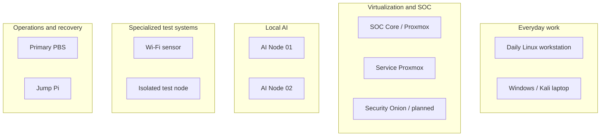

# ITLLERY — Public Lab Architecture

**Last reviewed:** 2026-11-21  
**Scope:** Logical roles only. This is **not** a real network topology or a diagram of deployed connectivity.

I build and test my cybersecurity lab on separate physical systems. The idea is to keep daily work, management, monitoring, local AI, backups and risky experiments from becoming one trusted environment.

## Network baseline documentation

- [Network infrastructure overview](network-overview.md)
- [Public-safe conceptual topology](network-topology.md)
- [Trust zones and segregation criteria](network-zones.md)
- [As-Is / To-Be status and open work](as-is-vs-to-be.md)
- [ADR-0001: segmentation and recovery](adr/0001-segmentation-and-recovery.md)

## Hardware at a glance

- **11 physical compute devices selected for this public overview.** These include my laptop and Raspberry Pi; not all 11 are running at the same time.
- **2 other machines** are excluded from the detailed public map: one reserved for future recovery, and one unassigned spare.
- Network equipment (MikroTik and managed switching) is counted separately.
- Virtual machines and containers are workloads, **not extra physical nodes**.

See [the public hardware overview](../hardware/README.md) for role and hardware summaries.

## Logical role map

The diagram groups devices by **purpose only**. There are no physical or logical connections shown, and it should not be used to infer my real VLANs, firewall policy, trust paths or switch layout.

## Separation principles

- **Daily work:** Not a place for high-risk experiments.
- **Management:** Restricted admin operations; details remain private.
- **SOC and monitoring:** Designed for endpoint events and selected monitored traffic. Monitoring coverage is tested, not assumed.
- **AI:** Separate compute and model experiments.
- **Isolated tests:** Controlled environments with explicit isolation boundaries. No ordinary trust path to personal systems.
- **Backup and recovery:** Kept apart from normal experiments, with restoration procedures validated separately.

## Current vs planned

I own the physical equipment listed in the hardware overview, but hardware ownership does not mean a full deployment is finished. Security Onion bare-metal monitoring, some network controls, and secondary backup arrangements are planned or being built. I'll label verified setups and experiments when I document them.

## What I don't publish

No real IP addressing, VLAN identifiers, port-by-port switch diagrams, router exports, WireGuard keys, exposed services, privileged access paths, backup encryption or recovery secrets, or actual malware samples. See [public sharing rules](../security/README.md).

I document individual projects only after performing and verifying them.
