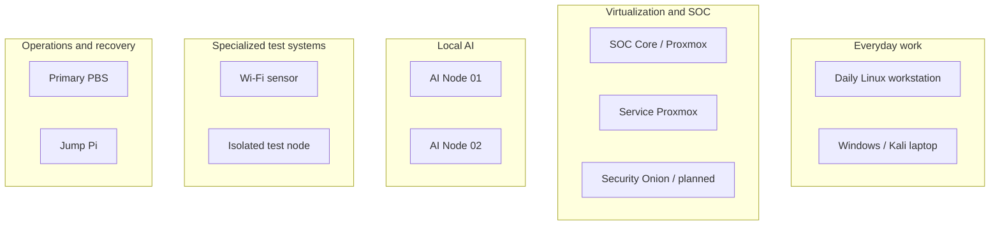

# How I've organized the lab

**Reviewed:** 2026-11-22

I keep daily work, administration, monitoring, local AI and security experiments on different systems. That makes it easier to understand what each machine is doing and reduces the chance of a risky test affecting something I rely on every day.

The diagram below shows the **roles** of the machines. It isn't a picture of the real cabling, VLANs or firewall rules. I keep that information in my private notes.

## Architecture notes

- [Network overview](network-overview.md)
- [Role diagram](network-topology.md)
- [Network zones](network-zones.md)
- [Current and planned work](as-is-vs-to-be.md)
- [Why I chose segmentation and recovery access](adr/0001-segmentation-and-recovery.md)

## Physical systems

My wider inventory contains **13 compute devices**. I document **11 devices** publicly, including my laptop and Raspberry Pi, and leave two reserve machines out of the detailed list. The MikroTik router and TP-Link switch aren't part of the compute-device count.

The [hardware inventory](../hardware/hardware-inventory.md) has the CPU, RAM, GPU and role details. Not every machine runs all the time, and having the hardware ready doesn't mean its intended software is installed.

## Roles in the lab

I use the daily workstation for normal work, while the Proxmox hosts run service and security workloads. The AI nodes are separate so experiments with local models don't have to share my daily environment. The Wi-Fi sensor and isolated test machine have their own purposes. Backup and recovery are also separate jobs.

Security Onion on dedicated bare-metal hardware is **planned**. I won't describe its packet capture coverage as finished until I've installed it and checked what traffic reaches the sensor.

## What I publish

I share the reasons behind the architecture, the parts I've tested and the problems I still need to solve. I leave real addresses, VLAN numbers, physical connections, management paths, keys and full configuration exports out of the public repository. My [sharing rules](../security/README.md) explain that in more detail.
