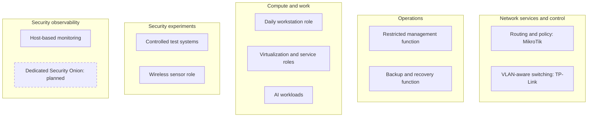

# Network roles

**Document:** NET-ARCH-002  
**Baseline:** 2026-11-21

I made this diagram to show which parts of the lab serve which purpose. It groups the router, switch, workstations, servers and security systems without showing how they are actually connected.

The diagram isn't a wiring map. It doesn't show real VLANs, trunk ports, access rules, management routes or the Security Onion mirror source. A box appearing beside another box doesn't mean the two systems can reach each other.

The monitoring role is also still being developed. I haven't verified full Security Onion packet visibility, and a drawing can't demonstrate isolation or successful recovery from a backup.

I keep the real Layer 1/2 connections, IP addressing, firewall exceptions and monitoring paths in private documentation. The reasoning behind the separation is in [ADR-0001](adr/0001-segmentation-and-recovery.md).
