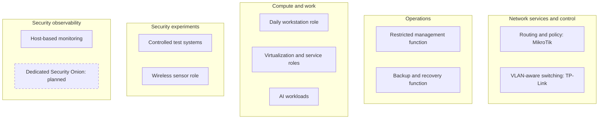

# Network Topology | Public Role Map

**Document ID:** NET-ARCH-002  
**Revision:** 1.0  
**Baseline:** 2026-11-21  
**Classification:** PUBLIC / SANITIZED

## Diagram scope

This diagram groups functions by **role**, not by physical connection. It does not disclose live cabling, trunk relationships, security boundaries, IP addresses, actual VLAN IDs, management routes or SPAN source ports. The location of a box does not mean it is reachable from any other box.

## How to interpret this diagram

- **Known components:** The network includes a MikroTik router, managed TP-Link switching and the documented lab roles.
- **Not shown:** Port-to-device relationships, network identifiers, exact routing paths, actual firewall permits, management entry points and sensor wiring.
- **Not yet established:** Complete Security Onion packet visibility across all desired traffic classes.
- **Not a test report:** A role diagram cannot prove L2 isolation, L3 filtering or the ability to restore from backup.

## Private engineering documents

The complete private set should include an as-built Layer 1/2 connection map, Layer 3 addressing and routing plan, firewall rule inventory, management dependencies and a separate monitoring source-to-destination map. These records are intentionally **not** part of this public repository.

For the decision rationale, see [ADR-0001](adr/0001-segmentation-and-recovery.md).
