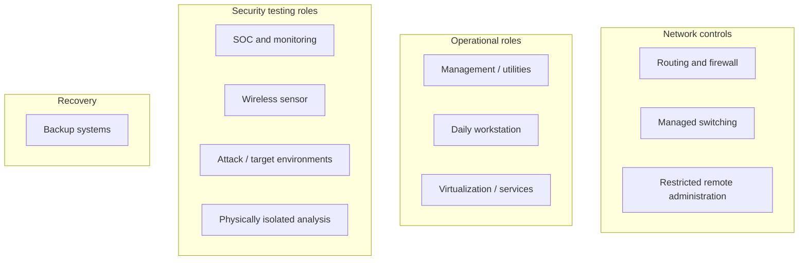

# Network Architecture

**Project:** ITLLERY Homelab  
**Document:** NET-ARCH-001  
**Reviewed:** 2026-11-21  
**Status:** Work in progress — selected controls implemented and tested  
**Scope:** Public, sanitized architecture. Not a live configuration or connectivity map.

## Purpose

I use the network to separate daily work, administration, hosted services, monitoring and security experiments. The aim is to make access intentional and testable instead of putting every device in one trusted network.

This page describes the design and the controls I have actually worked on. It deliberately does not contain live addresses, VLAN numbers, firewall rules or administrative access paths. Those belong in my private operating documentation.

## Security zones

| Zone | Purpose | State |
| --- | --- | --- |
| Daily work | Workstation, development and normal internet use | **Implemented / tested** for basic connectivity |
| Management | Administration and shared network utilities | **Implemented / partially tested** |
| Services / SOC | Virtualized infrastructure and defensive tooling | **Implemented / partially tested**; isolation rules configured |
| Wireless sensor | Dedicated wireless monitoring system | **Network port prepared**; endpoint deployment pending |
| Attack and targets | Controlled attack simulations and intentionally vulnerable systems | **Network segments staged**; workloads and policy tests pending |
| Monitoring | Dedicated network observation and detections | **Planned**; Security Onion and capture validation pending |
| Backup / recovery | Recovery workflows kept separate from ordinary experiments | **Partially implemented**; final access and restore tests pending |
| Isolated analysis | High-risk analysis on a physically separated connection | **Port separated**; full safe operating procedure pending |
| Guest / IoT and future ranges | Additional untrusted test environments | **Staged**, not production-ready |

## Architecture model

The diagram groups functions. **It does not show real wiring, routing, firewall exceptions or trust paths.**

## Control principles

- **Default deny for routed IPv4 traffic:** explicit allows are documented and verified before broad access is removed.
- **Least privilege:** administrative services are restricted independently of ordinary inter-zone traffic.
- **Defense in depth:** the firewall, device service settings and physical separation serve different purposes.
- **Controlled testing:** an isolated port alone is not proof of safe malware handling. Host configuration, other interfaces, recovery and operational controls also need validation.
- **Monitoring is measured:** a configured SPAN destination is not evidence of complete visibility. Capture and detection coverage must be tested when monitoring is deployed.
- **Change safety:** configuration changes use a known management path, Safe Mode where supported, a rollback option and positive/negative tests.

## Verified work to date

The following observations come from the November 2026 build and test session, not from a formal end-to-end security assessment:

- The daily workstation retained internet and management connectivity after its network migration.
- Direct new IPv4 connections between the daily-work and management segments were denied in both directions; firewall drop counters increased during testing.
- A final IPv4 forward-chain deny rule was enabled, and its counters increased when deliberately disallowed traffic was generated.
- IPv4 FastTrack was disabled during ACL testing. Existing connections and special protocol exceptions require separate validation.
- Selected router administrative services were disabled or restricted; administrative SSH access was tested from two different access contexts.
- Router configuration export and system backup were created for private storage.

**Limitations:** IPv4 forwarding tests are not a full penetration test; some configured services and hosts may still require additional ACL exceptions. IPv6 forwarding was disabled and local router advertisements were disabled. A change to IPv6 router-advertisement acceptance requires a planned router restart before it can be treated as fully applied.

## Pending validation

1. Review the complete router **input** policy and document management-service exposure.
2. Validate final inter-zone ACLs using both permitted and denied traffic, including fresh connections and any relevant special cases.
3. Complete switch management migration and remove temporary legacy dependencies safely.
4. Verify backup/recovery access and a representative restore.
5. Deploy the sensor and monitoring host; prove packet capture, log ingestion and detection coverage.
6. Confirm isolation procedures before any high-risk sample is handled.

## Evidence and documentation rules

Private records contain the exact IP plan, switch-port assignments, change commands, management access paths, backups and rollback instructions. Public evidence is included only after review and sanitization. A configured control is marked **Implemented**; it becomes **Tested** only when a reproducible check has passed.

See [public sharing rules](../../docs/security/README.md) and [physical component overview](02-physical-topology.md).
