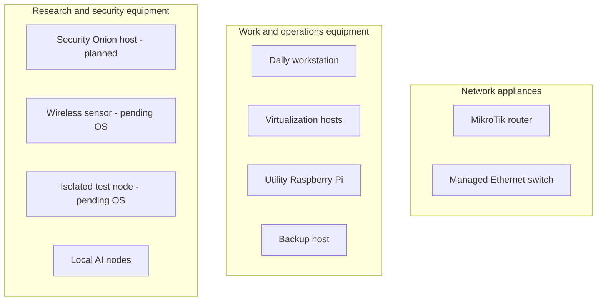

# Physical Components and Topology Overview

**Project:** ITLLERY Homelab  
**Document:** NET-PHY-001  
**Reviewed:** 2026-11-21  
**Status:** Partial build — public-safe reference only

> This is a **role-based view of the physical equipment**, not the as-built cable map. It intentionally omits real switch port numbers, actual links, management interfaces, addressing and SPAN assignments. The verified wiring diagram is maintained privately.

## Equipment groups

| Physical group | Public role | State |
| --- | --- | --- |
| MikroTik router | Internet edge, routing, segmentation and administrative VPN | **In use** |
| Managed TP-Link switch | Managed Ethernet connectivity and VLAN transport | **In use**; some future port roles pending |
| Daily Linux workstation | Development, university work and normal operations | **In use** |
| SOC Core and service virtualization hosts | Proxmox and hosted infrastructure workloads | **In use / evolving** |
| Raspberry Pi utility node | DNS and network utility services | **In use** |
| Dedicated Security Onion host | Planned network monitoring and packet analysis | **Hardware available; deployment pending** |
| Wireless sensor mini PC | Wireless observation and controlled tests | **Hardware available; OS deployment pending** |
| Isolated test mini PC | High-risk testing and analysis | **Hardware available; OS deployment pending** |
| AI compute nodes | Local inference and AI-assisted experiments | **Hardware available; configuration evolving** |
| Primary backup host | Backup and recovery workflows | **Available / recovery validation pending** |

For a fuller but still sanitized inventory, see [Hardware and node roles](../../docs/hardware/README.md). This page does not count virtual machines as separate physical computers.

## Public role layout

This chart is an **equipment classification**, not a map of physical connections.

## Deployment notes

**Implemented / observed**

- Core routing and managed switching were used during the November network changes.
- The daily workstation was tested for internet and administrative connectivity.
- The dedicated isolated-analysis router connection was removed from the shared bridge, with no router IP address or DHCP service configured on that interface.
- A dedicated network access configuration was prepared for the wireless sensor.

**Not yet proven or deployed**

- Security Onion operating system installation, capture interface configuration and SPAN verification.
- End-to-end observation coverage across the intended network segments.
- Final use of all reserved switch ports and deployment of the mini PCs.
- Backup connectivity across the relevant systems and restore testing.
- Host-side isolation guarantees for high-risk analysis.

## Physical security and change control

Before moving a cable or repurposing a switch port, I record its existing role, intended new role, affected systems and rollback procedure in the **private** port map. A public diagram is never used as a recovery runbook.

The isolated-analysis node must not be treated as safe merely because a router port has been separated: other network interfaces, removable media, host configuration and operational procedures matter too.

## Next checks

- Confirm each reserved port against the private cable and switch inventory.
- Finish the switch management migration and monitoring port plan.
- Install and test the relevant host operating systems.
- Capture sanitized evidence of real routing, isolation and monitoring tests.

See [Network Architecture](01-architecture.md) for logical security controls and current validation status.
